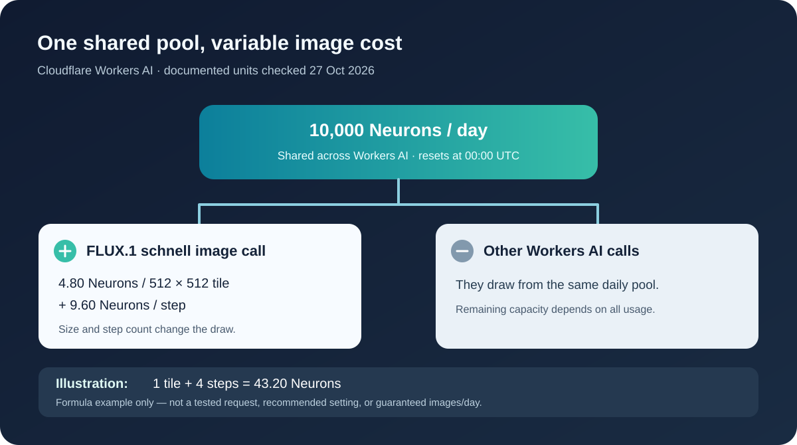

# Free AI Image Generation APIs: Compare Limits, Setup, and Who Pays

For a developer building a text-to-image prototype, “free AI image generation API” should mean a callable endpoint with a documented no-charge allowance for the image model you intend to use. A free browser generator, an open-weight model, and a free tier for *text* requests do not establish that.

Among the official routes checked on 27 October 2026, **Cloudflare Workers AI is the clearest starting point for a small hosted test**: it documents a daily free allocation and lists an image model. The choice depends on your model and settings; it says nothing about image quality or a guaranteed image count. Hugging Face’s current Inference Providers pricing gives Free accounts no monthly credits; Google marks its Gemini 3.1 Flash Image API’s Free Tier unavailable. The table below separates access, quota and payer so you can choose before writing an integration.

*Conceptual cover illustration; no provider performance or free access implied.*

## The comparison: allowance, setup, and payer

| Route | What the current docs support | Initial setup | Who pays when you use or exceed it? | Best fit for this decision |
|---|---|---|---|---|
| Cloudflare Workers AI | 10,000 Neurons/day shared across Workers AI; FLUX.1 schnell is listed for text-to-image. The quota is **not** 10,000 images. | Cloudflare account, Workers AI access, and the documented binding or REST credentials. | Within the published allocation: no Workers AI usage charge. On Free, operations beyond the limit fail; on Paid, overage is billed under Cloudflare’s terms. | A low-volume hosted prototype when the available model and quota unit fit. |
| Hugging Face Inference Providers, routed | The [Hugging Face Inference Providers pricing](https://huggingface.co/docs/inference-providers/pricing) page currently lists **no monthly credits for Free users**. | Hugging Face account/token, eligible provider and model, plus purchased credits or a qualifying plan. | Hugging Face bills routed usage; available plan credits apply where eligible. | Trying its provider ecosystem if you accept a paid path. |
| Hugging Face with a custom provider key | Same client routing can use your own upstream key, but Hugging Face credits do not cover these calls. | Hugging Face setup **and** a provider account/key. | The upstream provider bills you directly. | Existing provider relationship or a deliberate BYOK policy. |
| Google Gemini 3.1 Flash Image API | The [Gemini API pricing](https://ai.google.dev/gemini-api/docs/pricing) table marks image generation’s Free Tier **Not available**. | Google API project/key and a billing arrangement for the paid image tier. | Google’s paid image-model pricing applies. | A paid image requirement, not a zero-charge API test. |

Cloudflare’s [Workers AI pricing](https://developers.cloudflare.com/workers-ai/platform/pricing/) is the source for its quota and overage rules. These are documented terms at the check date, not account-level entitlements or a matched-prompt image-quality test. “Free” can describe the account, a web UI or a different model while the specific image API still costs money.

## Cloudflare: a daily allowance with a shared unit

Cloudflare’s free allocation is **10,000 Neurons per day** across Workers AI, resetting at 00:00 UTC. The same pricing table lists FLUX.1 schnell at **4.80 Neurons per 512 × 512 tile plus 9.60 Neurons per step**. A larger image, different step count or other Workers AI calls use a different share. That is why a single “free images per day” figure would mislead.

<picture>
  <source media="(max-width: 600px)" srcset="assets/shared-neurons-narrow.svg">
  
</picture>

*Quota mechanism from [Cloudflare Workers AI pricing](https://developers.cloudflare.com/workers-ai/platform/pricing/). The 43.20-Neuron example is arithmetic, not a measured call.*

As an *illustration of the published formula*, one 512 × 512 tile with four steps would be 4.80 + (4 × 9.60) = **43.20 Neurons**. Dividing 10,000 by 43.20 suggests about 231 such requests if nothing else consumed the allowance. This is arithmetic, **not** a tested output count, recommended setting or guaranteed quota. Confirm the model’s accepted parameters, current pricing row and your account’s limits before relying on it.

The image model page documents both a Workers binding and REST access. For an existing Cloudflare app, the binding may suit the deployment. For a separate backend, check the REST credentials and account identifier in Cloudflare’s guide. On the Free plan, crossing the allocation produces an error rather than silent free continuation; the Paid plan can incur overage. Build a usage guard and a fallback message even for a prototype. If your project needs a particular image style, license, privacy arrangement or steady production volume, this quota alone cannot decide the provider.

## Why other “free” labels can mislead

**Hugging Face offers an image API, but its Free account currently has no recurring image-credit allowance.** Its [text-to-image API documentation](https://huggingface.co/docs/inference-providers/tasks/text-to-image) shows `InferenceClient` and model/provider selection. Its pricing page, however, says Free users have **no monthly Inference Providers credits** and can purchase credits or upgrade. Search snippets seen during this research still advertised a $0.10 monthly Free credit; the fetched official page contradicted that snippet. Treat the live price table as the decision source and recheck it before signup.

The billing distinction matters even if the code looks similar. With Hugging Face routed inference, Hugging Face handles provider routing and billing. With a custom provider key, the underlying provider bills your account and Hugging Face plan credits do not apply. BYOK can simplify client code, but it does not make the upstream image call free. Model availability also depends on the selected provider; a model page in a catalog is not proof that your token can invoke it.

**Google’s free Gemini API label is model-specific.** The pricing page may show free usage for some Gemini models and Google AI Studio access, but the Gemini 3.1 Flash Image row marks Free Tier input and output as “Not available.” A free interactive test in AI Studio is not evidence of a no-charge production API endpoint. For a zero-upfront prototype, exclude this image endpoint unless its model-specific pricing or your project eligibility changes. Check the exact model row and regional billing eligibility before integrating.

## A five-minute payer and eligibility check

Before adding any SDK, answer these questions for the *exact* image model and account you will use:

1. **Is there a callable text-to-image API?** Find the model’s endpoint or binding documentation. A gallery entry or browser demo is insufficient.
2. **What resets, and in which unit?** Daily shared Neurons, monthly money credits and a one-time trial are different budgets. Record the model, size/steps, reset time and whether other tasks share the pool.
3. **Who holds the bill?** For direct hosted access, inspect the provider plan. For routed access, distinguish platform billing from BYOK provider billing. Decide who can enable overage.
4. **What happens at exhaustion?** A blocked request, pay-as-you-go charge and automatic plan change have different product consequences. Design the app’s error state accordingly.
5. **Do rights and operations fit?** Check current model terms, output-use rights, data handling, availability in your region and support requirements. Those can outweigh an attractive free allowance.

Self-hosting an open-weight model is a separate route: an API you operate can avoid a hosted vendor’s per-call tariff, but hardware, power, deployment, maintenance and model-license obligations remain. It should not be called “free API usage” without counting those costs. A managed aggregator is also a separate billing and access relationship; the number of models it lists does not establish free image calls. These boundaries matter more than a long list of nominally free tools.

## Choose for the prototype; recheck before production

For a small hosted proof of concept with no image-generation charge, start by checking whether Cloudflare’s documented FLUX.1 schnell path and shared daily allowance fit your intended image settings. Choose Hugging Face if its model/provider flexibility is worth a purchased-credit or BYOK arrangement. Choose Gemini image generation only with a budget for its paid API tier. If you need control that these hosted routes cannot provide, price a self-hosted option rather than counting its compute as free.

This recommendation would change with a revised price table, your actual account eligibility, a different image model, higher volume, output-rights requirements or a matched evaluation of image quality. No image requests, latency measurements, account permissions or bills were tested for this article.

Moduck publishes this comparison and is itself an AI API aggregator and unified API platform for developers. Its product goal is to make model discovery and access clearer, but the evidence available here does **not** establish a free Moduck image-generation allowance or that a particular image model is callable from an account. If unified model access is relevant to your next evaluation, check Moduck’s current model and API documentation before committing to an integration. [Read the documentation](https://docs.moduck.ai/). Image-model availability and charges are not verified here.
